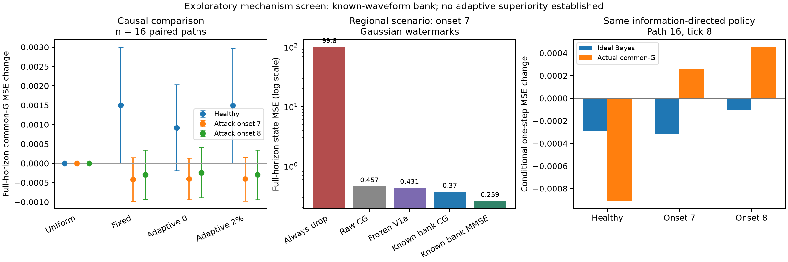

# B1 三假设理论评估与最小实验

2026-11-20，Asia/Shanghai。用户明确要求评估新推导、结合区域可观建议改进方案，并询问是否可以实验。本轮完成解析复核、三模型共同历史筛选和一个区域可观场景的探索性因果运行。

**结论：理论机制有正面支持，区域可观工程痛点成立；当前四阶方向策略尚未显示相对固定策略有明确的实际优势。下一步的技术缺口是把理想任务信息收益转化为原共 G 可实施输出收益，而不是继续增加方向参数或扩大仿真。**

- [完整评估与研究决定](assessment.md)
- [首次筛选事前配置](registration.json) · [后续因果运行事前配置](closed_loop_registration.json)
- [两份用户附件与来源清单](input_manifest.json)
- [精确代数及弱信号结果](results/theory_checks.json)
- [共同历史的一步筛选](results/summary.json) · [9 点高精度复核](results/high_accuracy_refinement.json)
- [区域可观/状态攻击分离诊断](results/geometry.json)
- [区域场景的实际因果结果](results/causal_summary.json) · [CSV](results/causal_common_g.csv)
- [原样 V1a 对照及顺序/批量条件模型交叉检查](results/validation.json)
- [图 PNG](results/evidence.png) · [图 PDF](results/evidence.pdf)



## 范围

冻结不稳定、稳定模型仅重用旧物理量测与旧水印历史。另行登记本地/健康邻居看不到第二不稳定模态的新区域可观模型，开发 8、评估 16 条物理路径，物理路径总数 24。三种真候选世界共享这些路径，不计为新的独立物理样本。

有限候选库只有无攻击和两个已知普通波形、起点 7/8 的候选。这对方法有利：知道候选方向和幅值，不能当成未知连续参数的原 V1a。真候选标签不参与设计；只用于模拟污染与评分。

当前一步的三模型筛选有 648 个历史比较点，每模型评估部分为 16 路径 × 3 候选世界 × 3 时点 = 144 点。这些点相关，不能当作 144 条独立路径。因果后续使用同一 16 条区域物理路径，仅在 7、8、9 拍启用当前设计；其余时间回到原 Gaussian 方向。完整文献查新、认证反馈资源等价与攻击失配验证不在本轮完成范围。

## 复算

Python 3.10+、NumPy、SciPy、Matplotlib。实际执行环境 NumPy 2.5.4、SciPy 1.18.1；环境与代码/输入哈希见 [provenance](results/provenance.json)。

```text
python -B theory_checks.py
python -B experiment.py
python -B refine.py
python -B validation.py
python -B closed_loop.py
python -B make_report.py
python -B verify_delivery.py
```

原始代码、原稿、冻结数据未改动。旧目录里的“不启动实验”属于此前建议；本轮按用户新授权运行隔离实验，不把旧建议解释成新的权限障碍。

登记数量的说明：`registration.json` 的 `engineering_replay` 自由文字曾写 32 条区域轨迹，但其明确路径索引为开发 8、评估 16；程序按索引执行，共 24 条独立区域路径，性能表只用评估 16 条。保留事前登记原文，在此披露不一致，不回写原文掩盖实际数量。
