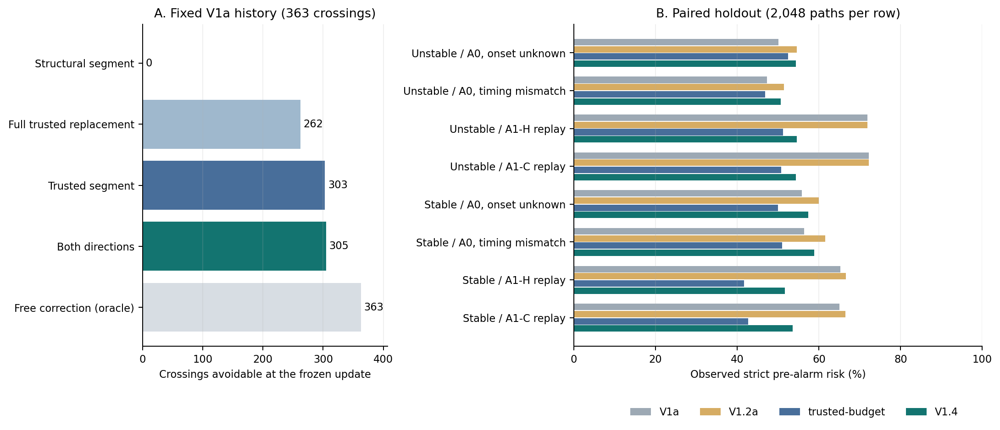

# 动作可达性与实际报警前风险

## V1.3 的冻结复算

读回 V1.3 两种模型每组 2,048 条独立风险轨迹，重新计算四类攻击共八个相对 V1a 的配对区间，八个区间都包含零。A1-C 首包严格早于报警的样本上，非稳定模型的平均风险预测为 1.53%，实际为 97.36%（1,477 条）。稳定模型分别为 9.55% 和 88.28%（1,408 条）。读回 14 个 V1.3 结果及 4 个 V1.2a 轨迹文件，逐一核对 SHA-256。用旧 96 条输入重跑 V1a 的后验，最大绝对误差为 $3.78\times10^{-14}$。再按旧发布结果回归 V1a、V1.2a 与共同报警，共 28 组后验对比。证据见 [V1.3 冻结复算](results/V13_freeze_recalculation.json) 和 [开发记录](results/development/summary.json)。

## 固定历史的几何结果

以下每行来自旧 96 条路径中的 V1a 首次严格报警前越界。保留两条 V1a 历史和同一健康当拍输出，只改变受攻端当前动作。解除表示剩余偏移平方严格小于 0.1。括号里的样本需使用连续双方向三角形，两个单方向线段均无法解除。

|物理模型和回放|原越界|仅调结构方向|完全可信替换|调可信方向|双方向三角形|
|---|---:|---:|---:|---:|---:|
|非稳定，A0 未知起点|48|0|32|33|34（1）|
|非稳定，A1-H|66|0|52|61|61（0）|
|非稳定，A1-C|70|0|53|63|63（0）|
|稳定，A0 未知起点|58|0|38|41|42（1）|
|稳定，A1-H|65|0|46|55|55（0）|
|稳定，A1-C|56|0|41|50|50（0）|
|合计|363|0|262|303|305（2）|

363 对方向都通过了秩二数值判据。各组夹角中位数从 10.68° 到 23.03°。首次越界恰为首包的有 292 条，双方向三角形可解除其中 254 条。两条需要双方向凸组合的记录都属于 A0，其中一条是首包。无约束二维离线校正的最小偏移平方为零。实际在线策略使用五条射线、名义账本与合法信息，故几何结果只衡量固定历史的可达性。逐条时刻、角度、最小奇异值、距离和重心权重见 [几何复算数据](results/geometry.json)。

## 同协议试验

所有共 $G$ 方法使用同一对同步五节点模型、同一水印、同一物理样本、同一归档扰动和同一原始报文报警。健康与受攻输出分别更新。观察窗为 32 拍，危险阈值为偏移平方 0.1，原报警的名义整段额度为 5%。动作可以从首包发生，报警后也依同一规则更新。真实状态、干净目标报文和配对健康输出仅在实验计分端使用。

|方法|实际更新|健康资源|
|---|---|---|
|V0、V1a|原更新、完整结构补偿|样本估算|
|V1.2a|沿结构方向采用原名义账本|整段期望健康 MSE 上界 2%|
|传统 GLS|原模板匹配的 GLS，沿用自身既有匹配门作补偿开关，共同报警仍取原始报文 BF|样本估算|
|完全可信替换|每拍以 $\hat y^T$ 代目标报文，共 $G$ 递推|完全放弃目标报文信息|
|可信量测条件 MMSE|每拍输出 $\hat x^T$|独立诊断可信信息的最佳期望精度|
|创新裁剪|按可信条件协方差将原目标偏差裁剪到 95% 椭圆内|样本估算|
|同账本单可信方向|只沿 $T$ 求可信条件平方损失最优动作，使用同一账本|整段期望健康 MSE 上界 2%|
|V1.4|按可信一致性选工作中心，在预算允许的射线中择优|整段期望健康 MSE 上界 2%|

旧 48、96、32 条集合用于开发。旧 32 条保留历史记录中每条扰动与其原始信号的配对，执行时只回放保存的记录。旧 96 条六组中 V1.4 相对 V1.2a 的报警前越界计数依次下降 2、20、19、4、17、13。两模型健康样本增量为 0.161% 和 0.282%，六组受攻 MSE 均符合预登记的 1% 容忍标准。旧非稳定 A1-H 组中，V1.4 比同账本单可信方向少 7 次严格报警前越界，受攻 MSE 低 2.62%。开发结果满足冻结门槛。

冻结代码后，两种模型各用新的物理、水印和回放抽样种子，生成 2,048 条健康样本及配对受攻路径。A0 起点从 3、7、11 拍抽取，时序失配组将实际注入缩短到 8 拍，辨识模板仍为 10 拍。A1-H/C 从冻结扰动库抽取，在新物理样本与水印上作防御回放。独立性针对新物理噪声、水印和冻结库的抽样。旧 32 条的原始配对用于另一种压力检查。两阶段都没有生成实时攻击策略或按防御输出调整扰动。

## 独立验证

### 报警前危险

每行 2,048 条。表内数字为 $\tau_D<\tau_A$ 的计数，所有方法使用该路相同的 $\tau_A$。完全可信替换与可信条件 MMSE 每行均为零，其健康代价见下。

|物理模型和回放|V0|V1a|V1.2a|传统 GLS|创新裁剪|同账本单可信方向|V1.4|
|---|---:|---:|---:|---:|---:|---:|---:|
|非稳定，A0 未知起点|1626|1025|1117|1620|1500|1074|1112|
|非稳定，A0 时序失配|1563|969|1054|1562|1451|960|1038|
|非稳定，A1-H|1476|1471|1471|1401|1232|1048|1117|
|非稳定，A1-C|1483|1479|1480|1394|1233|1039|1114|
|稳定，A0 未知起点|1472|1142|1228|1455|1355|1024|1176|
|稳定，A0 时序失配|1480|1154|1261|1470|1356|1043|1204|
|稳定，A1-H|1395|1336|1364|1360|1202|854|1059|
|稳定，A1-C|1386|1331|1361|1353|1218|873|1098|

相对 V1a，四个 A1 回放组的危险率下降 11.38–17.82 个百分点。用同路径的两类不一致计数构造 Clopper–Pearson 差区间，并对八组、三个参照同时校正。按非稳定 H、C 与稳定 H、C 顺序，百分点区间分别为 $[-20.17,-14.28]$、$[-20.79,-14.71]$、$[-16.93,-10.01]$、$[-14.73,-7.93]$。V1.4 在这四组的受攻 MSE 比 V1a 高 3.78%–9.26%。与 V1.2a 比，八组风险点值均下降，四个 A1 组和两个稳定 A0 组的同时区间在零以下。

与同账本单可信方向比，V1.4 八组风险点值均更高，四个稳定模型组的同时区间在零以上。V1.4 的受攻 MSE 比该单方向低 0.87%–2.41%。组合提供的是较低受攻 MSE 和较少健康精度消耗，代价是较高的报警前风险。对 A1 回放，裁剪的受攻 MSE 也低于 V1.4，其报警前危险计数更高。A0 未知起点时，V1.4 比 V1a 的受攻 MSE 高约 15.09%（稳定）和 15.68%（非稳定）。

### 首包、停止尾部和误补偿

首包危险若包括当拍已报警事件，会与严格报警前指标给出不同排序。以下按同一阈值计数。

|模型和回放|V1a 首包|V1.4 首包|V1a 首包且严格早于报警|V1.4 首包且严格早于报警|
|---|---:|---:|---:|---:|
|非稳定，A1-H|1933|1626|1427|1079|
|非稳定，A1-C|1979|1642|1450|1091|
|稳定，A1-H|1327|1484|1175|913|
|稳定，A1-C|1447|1680|1282|1052|

V1.4 在非稳定 A1-H/C 首包启用可信方向的比例为 55.03% 和 57.42%，稳定模型为 27.73% 和 28.47%。非稳定模型的首包相对可信校正投影均值为 0.1579 和 0.1652，高于结构方向的 0.1066 和 0.1119。稳定模型首包相对可信投影均值为 0.0655 和 0.0622，低于结构投影 0.1709 和 0.1790。相对投影包括健康端校正，分阶段日志保存了均值及负投影发生率。

V1.4 在四个 A1 组的停止尾部越界计数从 V1a 的 4、1、11、8 降到 0、0、0、0。两个 A0 组各留有一次停止后越界。该终点限于第 31 拍。V1.4 在健康样本启用可信校正的频率为 3.78% 和 3.43%，启用当拍的同历史实际平方误差增量均值为 0.01093 和 0.00865。这个增量只在离线比较中固定健康历史及结构动作。

### 整段健康精度

|模型|V0 健康 MSE|V1.4 健康 MSE|V1.4 相对 V0|同账本单可信方向相对 V0|完全替换相对 V0|
|---|---:|---:|---:|---:|---:|
|非稳定|0.2271153|0.2273349|+0.0967%|+2.031%|+29.27%|
|稳定|0.2278294|0.2278791|+0.0218%|+2.051%|+28.32%|

两模型的健康共同报警为 12/2048、9/2048。2% 证明控制总体期望，样本比值允许略超。可信条件 MMSE 的独立健康样本增量约 28.92% 和 28.10%。

完整数据、风险差区间、逐拍权重与账本、阶段 MSE 和恢复统计分别见 [独立验证](results/holdout/summary.json)、[配对统计](results/paired_comparisons.json) 和同目录的 NPZ 文件。图中的 A 面板是固定历史可达性，B 面板是独立完整闭环。两面板的动作和样本不同。

