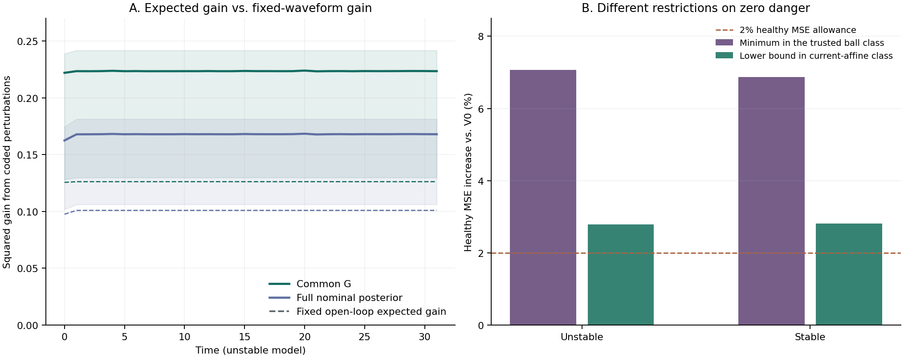

# 有限编码域能量下的增量安全—精度边界

基线为 [afcab9e](https://github.com/center-666/paperlast/commit/afcab9e4fa8728fab01ab1edc8420079cf474c7a)。使用原共 $G$、Gaussian 乘性水印、编码域总能量 $E=10$、原 BF 与 32 拍窗。

**有限能量使输出约束比固定安全球宽松，但没有消除当前报文仿射接收器的全窗零危险—健康精度矛盾。** 假定任一拍都可遭受单包扰动，仅由不读水印的固定扰动子集就可推出，两个模型若要保证全窗零危险，健康期望 MSE 增量至少约为 2.78%、2.81%，均超过 2%。这是范围明确的实质下界。它不否定当前报文非线性接收器，也不否定只要求零报警前危险的方案。

在相同范围内，2% 下全窗总危险最坏概率的必要下界约为 1%。普通随机混合的保守可行上界约为 90%。区间过宽，未据此引入新的补偿原型。本轮未提供实时 H/C 篡改与逐防御攻击优化。表格和首包、尾部等数值继续标记为冻结档案回放。

## 索引

- [定理 A、期望谱增益、信息权限及非线性包络](01_编码域增量传播与信息权限.md)
- [定理 B/C、精确可行性和风险区间](02_有限能量下的可行性证书.md)
- [七个冻结基线的成对复核与能量计量](03_冻结对照与独立证据边界.md)
- [文献对照与第三、四、五章组织](04_直接文献对照与第三四五章组织.md)
- [有理数数据](results/affine_frontier.json)、[水印上的谱积分](results/linear_influence.json)、[配对复核与能量数据](results/archived_comparison.json)、[交付核验](results/delivery_checks.json)

## 复算

Python 3.10 或更新。示例从本目录执行。参数 `--baseline ..` 指仓库副本根目录，省略时在本机读取原登记镜像。上轮完整 NPZ 由仓库提供。已有档案再生及验证不增设新物理种子。

~~~sh
python -m pip install -r requirements.txt
python -B -X utf8 affine_frontier.py --baseline ..
python -B -X utf8 spectral_influence.py --baseline ..
python -B -X utf8 archived_audit.py --baseline ..
python -B -X utf8 test_energy.py --baseline .. -v
python -B -X utf8 review_delivery.py
~~~
