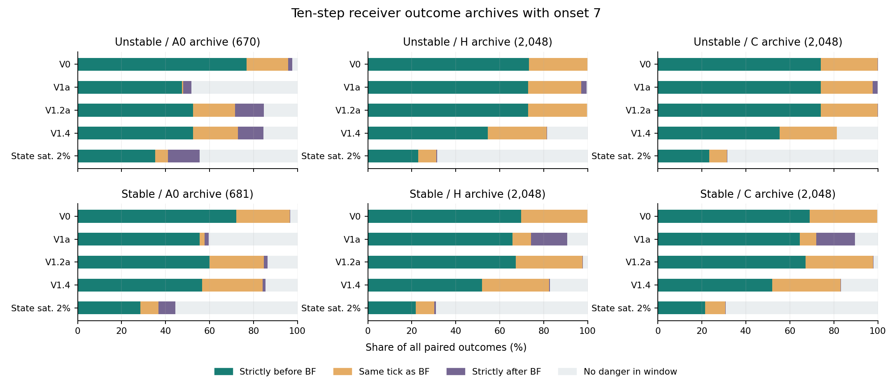

# 窗口 A 十拍档案的时序复核

## 样本与分母

从已保存的防御输出只读复算。A0 档案包含既有起点 3、7、11，均持续十拍。按起点 7 筛出非稳定模型 670 条、稳定模型 681 条。H/C 档案均起于 7，分别复核两个模型各 2,048 条。停止拍为 17，实际受扰拍为 7–16。另有持续八拍的旧错时档案，已从本报告的十拍对照排除。未使用窗口 B 来替代十拍样本。

30 组“模型、档案、方法”的固定起点 7 结果中，**每组出现危险后的多数都属于严格报警前**，占已出现危险样本的 62.1%–93.1%。这个比例的分母是已经危险的样本。总体风险率使用该组全部样本。每个格子为“严格报警前 / 同拍 / 严格报警后”的首次危险计数。

|起点 7 的档案|V0|V1a|V1.2a|V1.4|2% 状态创新饱和|
|---|---:|---:|---:|---:|---:|
|非稳定 A0，670|515 / 127 / 12|318 / 4 / 25|352 / 128 / 87|352 / 137 / 77|237 / 38 / 97|
|稳定 A0，681|491 / 166 / 1|378 / 15 / 13|408 / 169 / 12|386 / 187 / 9|194 / 57 / 52|
|非稳定 H 档案，2,048|1502 / 542 / 1|1494 / 494 / 49|1495 / 547 / 1|1118 / 550 / 1|468 / 171 / 6|
|稳定 H 档案，2,048|1427 / 620 / 0|1349 / 173 / 335|1380 / 618 / 4|1064 / 627 / 4|445 / 176 / 12|
|非稳定 C 档案，2,048|1518 / 529 / 1|1517 / 483 / 46|1517 / 530 / 1|1135 / 530 / 1|477 / 164 / 6|
|稳定 C 档案，2,048|1414 / 629 / 0|1322 / 152 / 361|1373 / 632 / 3|1063 / 638 / 3|440 / 186 / 6|

报警前、同拍、报警后和无危险四类完备分割样本。顺序是首次越界与首次报警的先后。未到达危险阈值的样本留在总体分母。

### 首包和右删失

- 在非稳定 A0 起点 7 组，V0 首包全危险 91 次，其中 80 次严格早于 BF，11 次同拍。稳定组对应 451、330、121。
- 在稳定 C 档案，V1a 首包全危险 1,423 次，其中 1,281 次严格早于 BF，142 次同拍。2% 状态饱和的对应数为 581、410、171。
- 时间差以 $\tau_A-\tau_D$ 定义。正值表示报警较迟。在稳定 C 档案上，V1a 仅对两个时刻都观测到的样本取中位数，值为 −1 拍。同时有 **1,265 条已经危险但至窗末仍未报警**。这两条事实可以同时成立。应报告删失和时间差分布，不能用已观测时间差的中位数替代总体及时性。
- 在六组档案中，2% 状态饱和的严格报警前计数均是同组五方法中最小。这个排序限于同一已存扰动和同一物理样本，不说明它针对重新优化或实时因果策略仍是最强。

### 实际 MSE 和停止后残余

在非稳定 A0 起点 7 组，V1a 的攻击段 MSE 为 0.26827，2% 状态饱和为 0.27598，排序与严格风险排序不同。V1a 的 347 条危险路径中，7 条的首次越界在停止拍起。这个分层的尾段 MSE 分别为 0.23171、0.23490。尾段 MSE 是对真实物理状态的误差。它不等同于停止后相对于健康输出的配对偏移。

[复算数据](results/archived_timing.json)保存全部五法、A0 起点 3/7/11、H/C 及健康各组。每张表包含攻击段与尾段实际 MSE、首次越界是否在尾段、窗内配对峰值、删失计数、时间差分布和相对 V1a 的配对风险差。既有任意尾段越界计数保留于完整组。A0 分层只记首次越界是否在尾段，因为保存的逐路径摘要无法重建每条分层路径的反复尾段越界。

## 原 2% 健康预算

用同一原健康集复算各法。原 32 拍健康 BF 分别报警 17/2,048、10/2,048。名义解析量使用同一 Gaussian 条件模型，未由告警频率重新定阈。百分比相对同模型 V0。斜线前为保存的名义条件期望估计，斜线后为真值误差的样本增量。

|防御|非稳定，名义估计 / 样本|稳定，名义估计 / 样本|解析健康增量|
|---|---:|---:|---|
|V0|0 / 0|0 / 0|定义参照|
|V1a|−0.0656 / −0.0743|−0.1186 / −0.1057|此处无解析 2% 证明|
|V1.2a|−0.1140 / −0.1176|−0.1604 / −0.1580|原名义上界 2%|
|V1.4|+0.1048 / +0.1353|+0.0533 / +0.0716|原名义上界 2%|
|2% 状态创新饱和|+1.9723 / +1.9065|+1.9913 / +2.0816|由冻结 Gaussian 前沿按名义 2% 求根|

因此稳定模型的状态饱和在本档案健康样本上为 +2.0816%，与名义期望的 2% 是不同对象。V0 的名义 MSE 为 0.22771118、0.22666559，样本 MSE 为 0.22878935、0.22605552。上述条件估计从已有名义完整条件平方误差数组复算。

## 论文能够回答的问题

|问题|当前证据|
|---|---|
|原十拍窗的危险主要发生在哪里|本档案在五方法的全部固定起点组中以严格报警前为主。多起点档案分层另见复算数据。|
|实时 H/C 是否强于固定波形|此处没有同权限、逐防御优化且独立检验的实时比较，无法判断。H/C 标签仅标明档案来源。|
|未知水印的影响有多大|前轮固定波形的最大期望平方增益与逐水印算子平方范数的期望有明确间隙。例如非稳定模型 V0 在第 31 拍约为 0.12614 与 0.22340。该间隙不估计 H/C 可达到的风险。|
|2% 状态饱和是否仍最强|既有档案内严格报警前计数最少。实时或完整因果类的排序仍无证据。|
|BF 的首包及时性是否为瓶颈|大量首包危险发生在 BF 之前，且有长窗删失。固定波形定理还说明统计校准使重叠支持上的零严格风险无法只靠报警取得。这是及时性瓶颈的证据。它未识别 BF 相对其他同校准检测器的性能差。|
|有限能量、统计报警、精度的严格关系|窗口 B 的当前报文仿射类无法同时满足零严格报警前风险和 2% 预算，依据是条件未报警证明和有理数证书。十拍窗口 A 的一般可行性仍未判定。|

七项指标都从已有稽核字段计算。实时攻击、权限单测和逐防御的攻击搜索未交付。用户规定的实时基础验收未通过，因此没有新增独立配对试验，也没有发布新的补偿版本。
