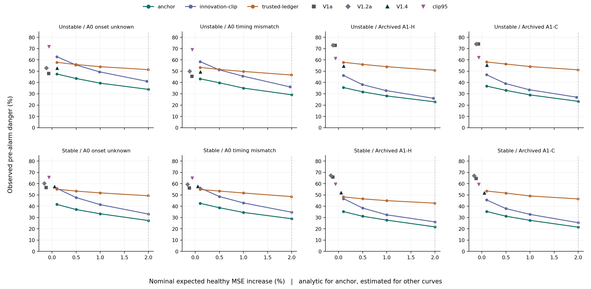
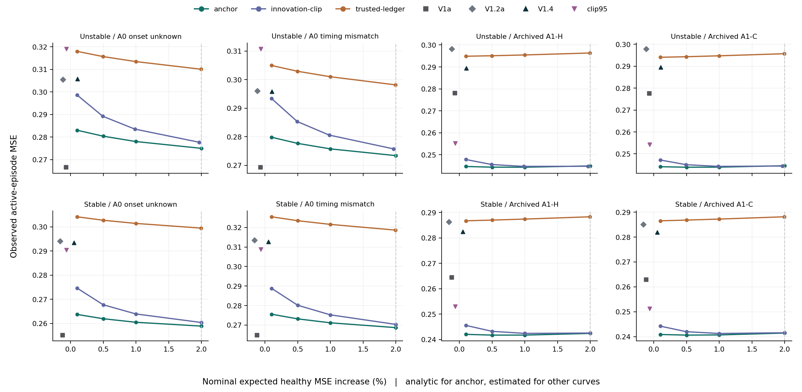

# 统一协议下的安全与精度比较

## 预登记与衡量方式

先完成 [安全球可行性证明与确定性复算](01_安全球定理与可行性.md)。随后以每模型 8,192 条仅健康样本校准当前报文创新裁剪阈值，固定代码、半径、阈值及种子哈希，再生成每模型 2,048 条独立物理及水印路径。各情形复用该模型的物理样本以便逐路径配对。A0 未知起点、A0 时序失配及 A1-H/C 均为冻结扰动档案的接收侧回放，档案选择不使用任何防御结果。A1-H/C 的档案标签说明来源，不能用于推断该策略在线遇到新路径的行为。

本轮使用固定共 $G$ 与同一原始报文 BF。危险为 $\|\hat X_k^a-\hat X_k^0\|^2\ge0.1$，严格报警前危险要求首次越界早于 BF 首次报警。首包全危险及首包严格报警前危险单独保存。受攻与健康接收器各自递推，同一路径保留各自的完整更新。评测在接收器输出后才读取物理真值。两个模型的健康 BF 分别报警 17/2048、10/2048。5% 是原 BF 的名义事件额度，样本报警率单独报告。

对健康精度报告三种数。固定半径锚定使用前沿公式的总体期望。名义账本给出整段期望增量上界。含 V1a、V1.4 及当前报文裁剪在内的操作点另用完整名义条件均值估计健康**期望**增量，用健康样本真实状态重新计算**样本**增量。所有攻击段 MSE 都用自己的受扰世界与物理真值计算。

## 方法和成本点

|方法|实现和成本口径|
|---|---|
|V0、V1a、V1.2a、V1.4|固定旧实现。V1.2a、V1.4 沿用 2% 名义期望账本，作为各自单独操作点|
|单可信方向与名义账本|沿 $G(z_k-\hat y_k^T)$ 单方向。分别使用 0.1%、0.5%、1%、2% 的名义额度|
|当前报文创新裁剪|计算 $u_k-G[1-t/\|\Omega_k^{-1/2}(z_k-\hat y_k^T)\|]_+(z_k-\hat y_k^T)$。独立健康样本校准四个 $t$，另含 V1.4 原 95% 阈值|
|可信参考锚定|把完整名义条件均值投影到 $\mathcal B_k(r)$。四个 $r$ 由解析健康前沿反求，通过改写目标报文实现，保持共 $G$ 增益|
|严格安全球|固定 $r=0.158$。认证 $4r^2=0.099856<0.1$|
|完全可信条件 MMSE|取 $r=0$。用作放弃目标链路的精度代价参考|

标准状态创新径向饱和在采用 $\mu_k-m_k$ 作为创新时逐点等同于锚定。本实验的独立裁剪基线采用 V1.4 的当前报文条件创新及原递推预更新，因此是不同的输入与中心。同口径实时判断所用的原始报文 BF 仍共享。

### 四个成本点的实测健康增量

每格前者为名义期望增量（锚定为确定性前沿，裁剪和单方向为独立样本条件期望估计），斜线后为使用真实状态的有限样本增量。单位百分比。单方向的解析上界是该行目标值。

|模型|成本目标|锚定|报文裁剪|单可信账本|
|---|---:|---:|---:|---:|
|非稳定|0.1%|0.100 / 0.067|0.100 / 0.113|0.100 / 0.016|
|非稳定|0.5%|0.500 / 0.456|0.493 / 0.494|0.499 / 0.396|
|非稳定|1%|1.000 / 0.942|0.983 / 0.953|0.999 / 0.877|
|非稳定|2%|2.000 / 1.906|1.965 / 1.882|1.995 / 1.842|
|稳定|0.1%|0.100 / 0.201|0.102 / 0.161|0.100 / 0.200|
|稳定|0.5%|0.500 / 0.597|0.500 / 0.554|0.500 / 0.621|
|稳定|1%|1.000 / 1.092|0.999 / 1.033|0.999 / 1.141|
|稳定|2%|2.000 / 2.082|1.999 / 2.023|1.997 / 2.170|

期望资格与样本百分比不会逐次相等。锚定用解析期望方程的数值根，表内用显示精度。报文裁剪是接近指定值的匹配，独立验证没有改阈值。四个目标点中报文裁剪与锚定名义期望增量的最大观察差约 0.035 个百分点。严格安全球的名义增量为 7.080% 和 6.874%，完全可信条件 MMSE 为 28.657% 和 28.290%。

## 报警前危险与实际受攻 MSE

各行 2,048 条。2% 组的计数，严格安全球及完全可信条件估计在同一组均为零。

|模型与回放|V1a|V1.2a|V1.4|单可信账本 2%|报文裁剪 2%|锚定 2%|
|---|---:|---:|---:|---:|---:|---:|
|非稳定 A0 未知起点|982|1085|1078|1052|841|694|
|非稳定 A0 时序失配|931|1024|1011|955|739|596|
|非稳定 A1-H|1494|1495|1118|1042|533|468|
|非稳定 A1-C|1517|1517|1135|1049|553|477|
|稳定 A0 未知起点|1158|1236|1174|1010|678|560|
|稳定 A0 时序失配|1151|1217|1180|994|711|593|
|稳定 A1-H|1349|1380|1064|876|536|445|
|稳定 A1-C|1322|1373|1063|953|521|440|

在四个成本点、八组共 32 个对照中，锚定比同目标报文裁剪少 3.17–15.33 个百分点的报警前危险。对全部 32 个比较另作 Bonferroni 同时校正，Clopper–Pearson 配对差区间的最大上端为 −1.05 个百分点。锚定的攻击段实际 MSE 在 30/32 个对照中较低，26 个配对近似 95% 点态区间上端低于零。非稳定 A1-H/C 的 2% 两组中，锚定比报文裁剪分别多约 0.00016、0.00016 MSE。两个区间均跨零。

按相同定义对比 V1a，锚定在本批 A0 回放中降低报警前风险，V1a 在 A0 的攻击段 MSE 仍更低。在非稳定 A0 未知起点的 2% 点，锚定和 V1a 的攻击段 MSE 分别为 0.27502、0.26666。稳定 A0 对应值为 0.25892、0.25519。完全可信估计虽具零偏移，但在同批 A1 回放中 MSE 约 0.294，比 2% 锚定的 0.241–0.245 高。

严格球的首包、全窗及尾部危险均为零，且解析直径证书适用。2% 锚定仍发生危险，其峰值配对偏移平方接近两个模型的直径上界 0.2510、0.2447。示例为稳定 A1-C，2% 锚定的首包全危险、首包严格报警前危险和全窗严格报警前危险分别为 581、410、440，相同成本的报文裁剪为 690、485、521。全首包与严格报警前指标的分母均为全组 2,048 条。

三种方法在四个成本点的横轴使用名义健康期望或其独立估计，纵轴使用真实闭环样本。严格球和完全可信估计的成本超出四成本图范围，表格和数据保留。详见 [逐操作点表](results/operating_points.csv)、[实验数据与逐法摘要](results/comparison.json)、[同时区间](results/paired_risk_intervals.json)。
