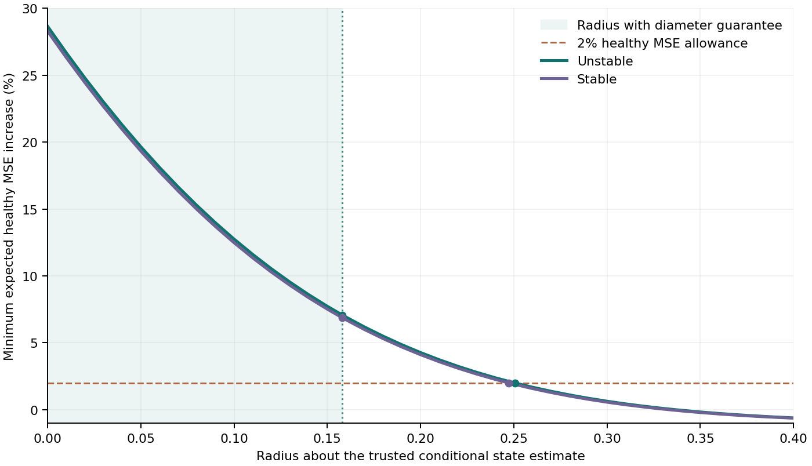

# 可信参考下的安全—精度可行边界

研究基线为 [3c145be](https://github.com/center-666/paperlast/commit/3c145beb43beee9672300030b7a3c83350973e37)。在两个冻结共 $G$ 模型中，若要求可信中心球的直径统一保证成对偏移平方低于 0.1，最优健康期望 MSE 增量也至少约为 7.07%、6.87%。两个值均高于 2%。这个结论的量词是同一可信中心球内的因果输出。

独立回放中，放宽半径后的锚定在 0.1%、0.5%、1%、2% 四个名义健康成本点比当前报文创新裁剪风险低。锚定与同信息的标准状态创新饱和严格等价，已作为健康前沿和鲁棒估计基线。相同可信输入下，硬安全球的解析界涵盖任意目标报文。放宽半径的实证来自有限回放。

## 交付索引

- [定理、共 G 可达性与精确证书](01_安全球定理与可行性.md)
- [统一基线、首包和独立配对对照](02_统一基线与独立比较.md)
- [验证协议及实时证据边界](03_实时证据边界与独立协议.md)
- [逐式近邻对照与一个中心主张](04_直接近邻与中心主张.md)
- [第四、五章技术修订](第四第五章技术修订.md)
- [全部操作点的数据](results/operating_points.csv)、[解析曲线](results/frontier.json) 与 [核验清单](results/delivery_checks.json)

## 复算

使用 Python 3.10 或更新版本。本次使用单线程 OpenBLAS。前两条产出定理所需确定性结果及基本测试。随后冻结只用健康输入校准的裁剪参数，再评估独立配对回放。若使用 GitHub 仓库副本，从本目录以 `--baseline ..` 参数指向仓库根目录。本机工作区可省略该参数，默认沿用已登记的研究镜像。复算将重写本目录的相应输出。

~~~sh
python -m pip install -r requirements.txt
python -B -X utf8 frontier.py --baseline ..
python -B -X utf8 test_frontier.py -v
python -B -X utf8 experiment.py --baseline .. --phase calibrate
python -B -X utf8 experiment.py --baseline .. --phase holdout
python -B -X utf8 review_outputs.py
~~~

核对上游 V1.4 全部旧验收文件时需要它的完整 NPZ。若仓库里只有旧分卷，先运行 `python -B -X utf8 ../JFI_V14_dual_direction_accommodation/checks/restore_holdout.py` 按既有 SHA-256 恢复。在本轮结果中，NPZ 只保存各方法的误差、峰值及事件计分等资料。其方法列顺序由 comparison.json 的 method_table 给出，时间索引 32 表示该窗未发生事件。

第三阶段未交付实时 A1-H/C 攻击生成、执行或针对防御的攻击参数优化。接收端因果比较使用独立物理数据及固定档案，另有范围明确的防御侧逐路径证明。
