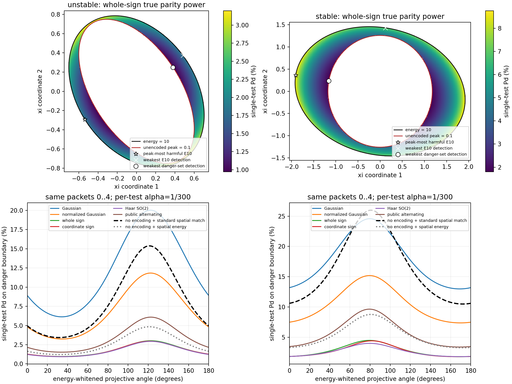

# 报告2：危险方向与检测弱方向的错配

日期：2026-11-14。固定原稿相容聚合五节点实例、攻击边0→1、原自主编码域攻击、L10、总能量10、D=.1，偏移评价b1…b15。前四包健康，监测在攻击起点重置。原稿/阶段文件不改。

## 1. 危险集合与比较对象

本轮共同集合由**无水印潜在峰值**定义：`ξᵀWξ≤10`且`max_n ξᵀS₀,nξ≥.1`。它固定后用于所有水印，不因水印实际放大或抑制重新改集合。它不是各方案实际危险路径的集合，也不是无条件MSE门槛。

报告1已严格认证：主链Au的峰值二次型是S₀,10，As是S₀,1；两者在全能量方向上均严格危险。因此所有射线都含危险区段，不能把危险攻击近似为单个特征向量或一个窄危险子空间。

令`ξ=r W⁻¹/²v(θ)`。同一射线上的普通条件非中心参数随r²增加，实际混合功效也不减，所以危险集合最低功效可在

\[
r^2=D/q_{\max}(\theta),\qquad
q_{\max}(\theta)=\max_n v^\top W^{-1/2}S_{0,n}W^{-1/2}v
\]

求取。这是解析径向降维，角方向最小值仍来自数值搜索，未作全局区间认证。不能把角度变化全部归因于“水印漏掉某个危险子空间”：径向能量也随角度变化。

## 2. 条件功效及正常协方差

H₀=I₂，完整五包窗口为0…4，奇偶残差取四个相邻差分。正常`q_t=w_{t−1}+v_t−Av_{t−1}`，Θ的对角块为`I+.5I+.5AAᵀ`，上下邻块为`−.5Aᵀ/−.5A`。给定与物理噪声独立的秘密实现，

\[
D(M)\xi=\operatorname{col}_{t=1}^{4}
(M_tA^t-AM_{t-1}A^{t-1})\xi,
\quad J\sim\chi^2_8(\xi^\top D^\top\Theta^{-1}D\xi).
\]

每检验α=1/300；15次预定检验总体误报≤.05由并集界保证。**这里报告的是第4包时刻单次功效，未提前获得未来包，也不是未知起点事件检出率。** 实际功效必须先算每个实现的非中心卡方尾函数，再积分。没有用EΛ代替实际Pd。

## 3. 共同危险集合内的最弱真实单次功效

|已有编码＋普通奇偶|Au最低Pd|As最低Pd|
|---|---:|---:|
|无水印|.3333%|.3333%|
|原Gaussian|6.1320%|12.9875%|
|平均信号能量归一化Gaussian|3.2425%|7.3741%|
|独立整体符号|.9652%|1.7906%|
|独立逐坐标符号|.9421%|1.7947%|
|独立SO(2) Haar|.9368%|1.8041%|
|公开整体交替|1.5275%|3.3860%|
|公开逐坐标交替|约.3334%|约.3335%|
|公开R90|约.3348%|约.3462%|

整体/逐坐标首五包分别精确平均32/1024个符号词；Gaussian/Haar使用固定种子Sobol积分1024/4096/8192阶诊断。As Gaussian最低Pd在4096→8192节点时约.130366→.129875，不将微小差异称为严格改进。所有随机混合方案的角最小值均未全局认证。

在Au，危险峰值是终端b10，本轮径向边界恰与此前共同P3-pot相同；在As，危险来自首包，不能沿用旧终端P3不可行的判断。完整方向、能量、潜在峰值、真实期望损害和每拍矩均在`danger_detection_comparison.json`。

图上部是在实际ξ坐标中的危险区域，颜色为整体符号真实有限混合Pd；空白内区未达危险阈值。三种标记分别为全能量最危险方向、全能量最弱检测方向和危险集合最弱检测初值。图下部将所有方案放到相同最小危险径向边界；标准空间匹配是已知起点的普通强基线，不是新水印。

## 4. 错配成立的准确含义

**弱检出且潜在危险的攻击确实存在，但没有得到集中、不可替代的定向设计机会。** 整体符号危险集最弱检出初值的能量约Au5.55675、As3.70378，使普通符号检测功效接近名义水平。这不是对所有方向求得的全局最低危险能量（Au约5.54870）。Gaussian对这些方向的功效更高，同时明显放大实际偏移；需要与损害一起评价。

最危险方向、全能量最弱检测方向和危险集最弱方向确实不同；这种差异只是量化现象，不构成新机制的证明。危险射线全覆盖、公开交替表现、空间强基线，以及有限信噪比首包边界共同削弱了“只针对少量遗漏方向补水印”的动机。

隐蔽性也是检测器相对的：无水印完整内部奇偶窗消去了原自主轨迹，但可信本地量测提供的空间残差并不消去它。不能把“对这个奇偶投影为零”扩成“对所有合法接收信息统计不可检测”。

## 5. 复核与范围

`danger_detection_compare.py`只读调用上一轮矩阵函数，不执行旧入口；新矩全部在本目录写出。`danger_detection_check.py`用第二套vec/Kronecker传播和有限符号枚举核对15个前缀矩，差在3×10⁻¹⁵以内。没有网络物理噪声样本、新攻击优化器或新水印。

报告3另给有限首次报警CDF/PMF界，不以本表替代。标准GLRT只保留为已知起点参考，未恢复统计量微调分支。报告中的5节点结果也不冒充原50节点实验复现。
