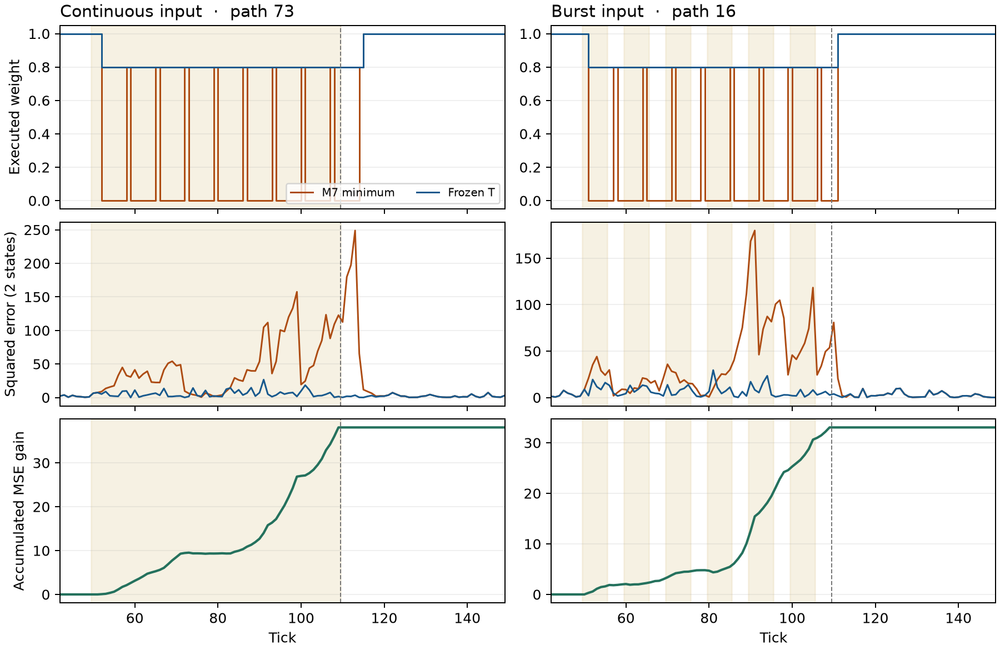

# 强水印下的融合收益归因

在不稳定 U、节点 35 量测噪声协方差加倍的配置，节点 26 依靠 35→26 获得后两维的互补量测。固定类别表在目标报警拍取 0.8。相对 M7 当前最小合法权重，固定表在全部 1,024 条留出受扰路径上都降低了缺失块 MSE。按任务 3 冻结规则重算健康代价后，0.6 在这个配置削弱了间歇关闭拍和停止后的恢复。论文联合策略采用禁止相邻重复旋转和按链路类别、动力学冻结的权重表。匹配分数继续用于检测。

## 同路径四格与交互

主格的 512 条恒定输入路径和 512 条六开四关路径等权。表内数值直接来自任务 4 的逐路径数组，损失是两个分量平方误差之和在 [50,110) 的时间均值。每行各策略共用七边报警流，跨水印共用物理路径。最后一列保留原任务 4 登记的硬拒绝单元。[四格与诊断组直接读数](fusion_attribution/primary_cells.csv)

| 水印 | 冻结表 T | M7 最小合法权重 | 直接拒绝 q=0 |
|---|---:|---:|---:|
| 独立四态旋转 | 8.92743 | 57.55514 | 36,921.12845 |
| 禁止相邻重复 | 7.11721 | 57.49820 | 44,292.69936 |

禁重复行的 T−M7 为 −50.38099，原配对 95% 区间 [−53.29465, −47.53485]。固定 T 时，禁重复减独立旋转为 −1.81022 [−1.91805, −1.70386]。可行基线上的配对差中差为 −1.75328 [−5.12665, 1.67574]，主格数据允许正负两种交互方向。直接拒绝在两水印各自的主格分别出现 54,184 次和 57,406 次违规（独立、禁重复）。M7 是七拍数值筛查。[配对区间](task4_confirm/paired_direction_corrected.csv) · [M7 交互](task4_confirm/paired_m7_interaction.csv)

## 50.381 来自哪些路径和时段

以 M7 减 T 表示收益，路径中位数为 **34.951**，P99 为 **239.523**，范围为 **0.908 至 369.900**。收益最大的 1 条对均值贡献 0.361；最大的 11 条合计贡献 2.936，占 5.83%；最大的 52 条贡献 20.06%，最大的 103 条贡献 32.49%。其余 921 条仍贡献 67.51%。受益广度和尾部放大在这批路径中同时可见。[逐路径贡献及编号](task4_confirm/M7_PATH_CONTRIBUTIONS.csv) · [分布与累计贡献](task4_confirm/M7_PATH_DECOMPOSITION.json)

| 输入与窗口 | M7 最小合法权重 | T | M7−T |
|---|---:|---:|---:|
| 恒定，全受扰窗 | 63.200 | 8.064 | 55.136 |
| 六开四关，全受扰窗 | 51.796 | 6.170 | 45.626 |
| 六开四关，36 个活动拍 | 50.526 | 7.988 | 42.538 |
| 六开四关，24 个关闭拍 | 53.700 | 3.443 | 50.257 |
| 恒定，最终恢复 40 拍 | 16.136 | 2.364 | 13.772 |
| 六开四关，最终恢复 40 拍 | 5.774 | 2.245 | 3.528 |

主窗全部 60,204 次目标报警中，T 全部接纳 0.8；M7 最小权重有 52,024 次取 0，8,180 次取 0.8。冻结矩阵在 q=0 时有 $K_{26}[2:,:]=G_{26}[2:,:]=0$（从零起算的后两行），缺失块的齐次递推等于原不稳定动力学块，谱半径为 1.09193。q=0.8 时联合观测矩阵满秩，四维 F 的谱半径为 0.62251。两种矩阵说明连续低权重期间，误差如何失去量测校正；路径重放量化了过程噪声、污染和切换共同作用的实际差值。两条策略在同一受扰窗上都通过 M7。[分窗分布](task4_confirm/M7_PATH_PHASES.csv) · [逐拍均值](task4_confirm/M7_PATH_TIME_SERIES.csv)

下图的两条真实路径分别最接近各输入组的收益中位数。每列从上到下为目标边实际权重、节点 26 后两维平方误差、累计受扰窗收益。累计值按 60 拍归一，第 109 拍等于该路径整窗 MSE 差。阴影标出真实活动拍，只用于离线标注。[最大收益路径对照图](fusion_attribution/path_largest.png) · [作图数据](task4_confirm/M7_EXAMPLE_TRACES.csv)

## 重算健康代价与匹配分数的决策增量

任务 3 已归档训练表、分数分位、可行掩码、回退规则和独立开发评价。其主格开发受扰窗 H−T 为 +0.23055 [0.19946, 0.26246]，恢复窗为 +0.11131 [0.10185, 0.12115]；D1−D0 的动作和两项损失差均为零。任务 4 原确认只执行 T、两种拒绝和全接纳。公开补充方案后，用已冻结的任务 3 模拟器在既有确认路径上重放 H、D0、D1，读取原报文、匹配分数与报警，拟合参数数目为零。这是训练外路径上的事后消融。20,000 次分层 bootstrap 保留同一物理路径的全部策略和端点，各区间为逐项 95% 区间。[补充方案](TASK4_SUPPLEMENTAL_ABLATION_PROTOCOL.md) · [逐配置配对表](fusion_attribution/paired.csv)

| 主格端点 | H−T 及区间 | D1−D0 及区间 |
|---|---:|---:|
| 受扰全窗 MSE | +0.23600 [0.21450, 0.25774] | 0 [0, 0] |
| 突发活动拍 MSE | −0.02386 [−0.05781, 0.01117] | 0 [0, 0] |
| 突发关闭拍 MSE | +1.15035 [1.11178, 1.19002] | 0 [0, 0] |
| 最终恢复 MSE | +0.10591 [0.09966, 0.11247] | 0 [0, 0] |
| 独立全健康路径 MSE | +0.000154 [0.000030, 0.000324] | 0 [0, 0] |
| 60 拍中动作分歧的比例 | 97.99% [97.92%, 98.05%] | 0% [0%, 0%] |

H 与 T 在主格 60,204 次目标报警上全部分歧。恒定输入 H−T 为 +0.02618，六开四关为 +0.44583，二者等权得到 +0.23600。用完整突发活动/关闭窗口计算，其加权差正好是 $0.6(-0.02386)+0.4(1.15035)$。主格 D1 和 D0 在 60,204 次报警上都选择同一动作；D1−T 与 H−T 的损失差相同。全部 12 个配置中，H−T 在其余 11 个配置的受扰 MSE 差为零。R 的六个配置中，匹配分数改变约 0.20%–0.45% 的受扰窗动作，六个攻击窗配对区间均跨零。[动作与分母](fusion_attribution/action_counts.csv) · [执行权重](fusion_attribution/alarm_weights.csv) · [路径读数](fusion_attribution/paired_paths.csv)

**读数更正。** 原汇总 `absolute.csv` 和 `paired.csv` 中受扰路径的 `health_post20` 是受扰轨迹 [20,150) 全段。主格 T 旧表的 4.509 对应这个混合窗口，独立全健康留出才给出 **2.20885**。健康指标取每配置登记的 512 条 continuous_health。原表跨两输入平均的 `attack_inactive` 包含连续输入的零占位，单独报告关闭拍必须直接读 burst。任务 3 冻结文档中另有不一致的 H−T 点估计，+0.23055 可由最终开发配对表回读。原方案与确认锁字节保留，以上数值均注明路径和窗口。[全健康与受扰的直接读数](fusion_attribution/primary_cells.csv) · [任务 3 配对表](task3_dev/paired.csv)

## 复算

安装 NumPy 2.4.6、SciPy 1.17.1，使用冻结 D1 工作树与单线程 BLAS。设 `$archive` 为含 48 个 NPZ 的目录，从本研究目录运行下列命令。绘图另需 Matplotlib。

~~~powershell
python -B readback_joint_results.py $archive
python -B analyze_task4_m7_path_decomposition.py $archive
python -B replay_frozen_fusion.py $archive --workers 3
python -B plot_fusion_paths.py
~~~

归档重建包括 48 个文件、24,576 个路径行，以及按动作历史独立重算的整批 M7 违规次数。软件重放对全部 12,288 条受扰路径和 6,144 条指定健康留出路径逐一比对已归档 T、M7 最小权重的动作与对应损失。每条路径在每种策略下各推进一次。[独立回读核验](fusion_attribution/READBACK.json) · [消融重放身份](fusion_attribution/REPLAY.json)
