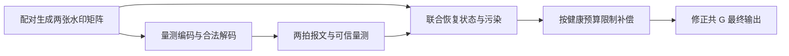

# 两拍水印如何帮助安全状态估计：详细问答

2026-11-21，Asia/Shanghai。延续审核者和合作者角色。本次说明依据已审阅方程，另给出无噪代数示例；不声称新增物理轨迹或完整系统的性能优势。

**用户：** 好的现在攻击知道了，那么现在设计的两拍水印的机制如何起作用，我希望你详细点

**助手（开始核对）：**

> 我会从发送、解码和两拍恢复方程讲起，具体说明这两拍为什么能把状态与攻击分开，再解释噪声、健康预算和共 G 补偿分别在哪一步起作用。讲解也会按你的要求归档上传。

**助手（核对所得）：**

> 关键在于“两条恢复方程互相补位”：非对角项的响应足够强时，用它消去攻击的一个坐标；响应弱时，改用两拍幅值的确定间隔。分支选择只依赖接收端已知的两张水印矩阵。噪声存在时还需限制补偿强度，这也是健康预算进入方案的位置。

下面给出本轮详细答复。

**这套机制的作用来自一个差别：真实状态按已知动力学变化，编码域攻击在解码后还要经过接收端已知的两张水印矩阵。把这两张矩阵配好，接收端就能利用响应差异，将必要状态信息与攻击污染分开。**

**1．先看接收端为什么需要这条受扰链路。**

当前区域模型有两个状态分量。可信本地通道能观测第一分量，但缺少第二个不稳定模态的信息；可疑邻居的报文恰好包含这部分信息。长期直接丢弃它，可能使必要状态失去足够观测。因此目标是继续利用邻居提供的状态信息，同时减少其中的攻击污染。

本轮二维推导使用 $A=\operatorname{diag}(\rho_1,\rho_2)$，其中 $\rho_1=1.04$、$\rho_2=1.12$，受检通道 $H_0=I$。合法节点掌握同步水印及动力学参数、可信本地量测和收到的受检报文；真实状态和攻击幅值仍是未知量。攻击继续采用原自主模型一致性攻击，完整位于有效区间内的两拍满足 $e_1=Ae_0$。这里用 $e_t$ 表示攻击，避免与水印向量的分量混淆。

**2．水印在哪里作用：正常量测往返恢复，攻击留下水印响应。**

发送端用 $q_t=M_t^{-1}y_t$ 编码。编码域叠加攻击后，接收端得到

$$z_t=M_t(q_t+e_t)=y_t+M_te_t.$$

在理想同步编解码下，合法量测通过两次逆变换恢复；攻击留下的解码污染则为 $\delta_t=M_te_t$。接收端知道 $M_t$，可以把这种变化纳入观测模型。这里没有假定接收端已知攻击；它要从 $z_t$ 里估计污染。

这一结论采用既有通信模型。若有额外信道噪声、量化或同步误差，应将其重新计入噪声和资源模型，不能直接沿用理想往返的结论。

**3．为什么要两拍：用一个状态参数解释两次观察，攻击系数却有已知差别。**

先看只含一个攻击参数的必要模态子问题。按已知动力学归一化后，两拍写成

$$Y_0=X+c_0\xi+N_0,\qquad Y_1=X+c_1\xi+N_1.$$

这里 $X$ 是第一拍的必要状态，$\xi$ 是块内攻击参数，$c_0,c_1$ 由已知水印确定。共同的 $X$ 来自动力学归一化，并不是假设物理状态静止；第二拍的新过程噪声进入 $N_1$。

无噪声时，相减给出

$$\widehat\xi=\frac{Y_1-Y_0}{c_1-c_0},\qquad
\widehat X=\frac{c_1Y_0-c_0Y_1}{c_1-c_0}.$$

例如取当前互补分位数支持内的一对系数 $c_0\approx0.550766$、$c_1\approx1.161652$。若教学示例中 $X=2$、$\xi=3$，则收到 $Y_0\approx3.652297$、$Y_1\approx5.484956$。代回上式恢复 $\xi=3$ 和 $X=2$。真实状态与攻击值只用于构造示例；恢复公式只读取量测和系数。

有噪声时，攻击估计误差含 $(N_1-N_0)/(c_1-c_0)$。独立水印可能让两拍系数非常接近；LC-TCW 则让该标量系数差有确定下界，从而控制这种除法造成的噪声放大。这说明它如何帮助恢复，但不代表独立水印下所有正则化或 Bayes 方法都失败。

**4．两张矩阵具体怎么配：一个控制幅值间隔，一个控制符号和比例。**

每拍仍采用

$$M_t=\lambda I+\beta_t\beta_t^\top
=\begin{bmatrix}p_t&q_t\\q_t&c_t\end{bmatrix},\qquad
\lambda=\tfrac12,\quad\beta_t=(a_t,b_t)^\top,$$

其中 $p_t=\lambda+a_t^2$、$q_t=a_tb_t$、$c_t=\lambda+b_t^2$。上一步的标量 $c_t$ 就对应这里的第二对角元，但该标量说明只覆盖单参数子问题。

第二坐标用互补分位数：$U\sim\mathrm{Unif}(0,1)$、$S\sim\mathrm{Unif}(0.45,0.55)$，取 $b_0=s_b\sqrt{Q(U)}$、$b_1=s_b\sqrt{Q((U+S)\bmod1)}$，其中 $Q$ 是 $\tfrac12\chi_1^2$ 的分位数，$s_b$ 为共享随机符号。这给出

$$|b_1^2-b_0^2|\ge\delta\approx0.178659,\qquad
\min(b_0^2,b_1^2)\le B_*^2\approx0.285326.$$

第一坐标将 $p=\lambda+a^2$ 的基准分布划为倍率 $\gamma=1.1$ 的几何区间。区间按基准落入概率抽取，随后在选中区间内独立抽 $p_0,p_1$，再取 $a_0=s_a\sqrt{p_0-\lambda}$、$a_1=-s_a\sqrt{p_1-\lambda}$。因此

$$1/\gamma<p_1/p_0<\gamma,\qquad q_0q_1<0\quad\text{几乎必然}.$$

每拍的完整矩阵分布仍与原 Gaussian 方案相同。刻意改变的是两拍的联合关系：第二对角元保持间隔，第一对角元比例受控，非对角元符号相反。它们共同服务于下一步的两条互补恢复方程。

**5．完整二维恢复：不能只靠标量差分，需要两种消元方式互补。**

将一组两拍重记为 0、1，令 $X=x_{2,0}$、$e_0=(\xi_1,\xi_2)^\top$，并记 $r=\rho_2/\rho_1=14/13$。接收端用带噪可信量测 $\ell_t=x_{1,t}+\varepsilon_t$ 构造

$$u_0=z_{1,0}-\ell_0,\quad v_0=z_{2,0},\quad
u_1=(z_{1,1}-\ell_1)/\rho_1,\quad v_1=z_{2,1}/\rho_2.$$

这一步不需要知道真实第一状态。可信量测相减消去了该状态，保留相应量测噪声。四个观测对应三个未知量：

$$
\begin{bmatrix}u_0\\v_0\\u_1\\v_1\end{bmatrix}
=
\underbrace{\begin{bmatrix}
0&p_0&q_0\\
1&q_0&c_0\\
0&p_1&r q_1\\
1&q_1/r&c_1
\end{bmatrix}}_{\mathcal B}
\begin{bmatrix}X\\\xi_1\\\xi_2\end{bmatrix}+\nu.
$$

四个观测本身并不保证能稳定求三个未知数；还要让矩阵的列保持足够独立。当前配对结构的作用可通过两个分支说明。

第一种消元为

$$u_1-\frac{p_1}{p_0}u_0
=\underbrace{\left(rq_1-\frac{p_1}{p_0}q_0\right)}_D\xi_2+\text{噪声}.$$

因为 $q_0,q_1$ 符号相反，$|D|=r|q_1|+(p_1/p_0)|q_0|$，两项不会抵消。若 $|D|\ge T=0.15$，可用这条方程恢复 $\xi_2$。

如果 $|D|$ 小，改用第二种消元：

$$w_0=v_0-\frac{q_0}{p_0}u_0=X+h_0\xi_2+\text{噪声},$$

$$w_1=v_1-\frac{q_1}{r p_1}u_1=X+h_1\xi_2+\text{噪声},\qquad
h_t=\lambda+\frac{\lambda b_t^2}{p_t}.$$

再相减得到 $(w_1-w_0)=(h_1-h_0)\xi_2+\text{噪声}$。当前参数满足 $\delta-(\gamma-1)B_*^2\approx0.150126>0$，配合小 $D$ 分支中的 $p_t$ 上界，可证明 $h_1-h_0$ 的绝对值有正下界。恢复 $\xi_2$ 后，再回代得到 $\xi_1$ 和 $X$。

因此核心并不是笼统地增加一个随机变化，而是**让两种消元方式不会同时退化**。接收端只需查看已知矩阵条目，就能选择分支；不需要真攻击值。指定模型下，当前左逆界为 $\|L\|_F\le20.334$。这控制噪声传播，不承诺实际噪声小或平均 MSE 一定优于所有基线。

两个无噪代数例子可直观看到分支作用：保持上面的互补第二坐标，取 $p_0=0.76,p_1=0.78$ 时，$D\approx-0.581441$，使用第一差分；取 $p_0=0.500001,p_1=0.500004$ 时，$D\approx-0.001977$，但 $h_1-h_0\approx0.610881$，第二差分仍可用。[示例脚本](mechanism_example.py)和[数值](mechanism_example.json)只展示代数关系。

**6．为什么还要健康预算：健康噪声也会被解释为攻击。**

在标量模型中，健康时 $\xi=0$，但 $Z=Y_1-Y_0$ 仍有噪声。直接全量反演会把这部分噪声变成不必要的补偿。当前标量候选采用

$$\widehat X=\bar Y-\frac{\bar c}{d}S_t(Z),\quad
d=c_1-c_0,\quad S_t(z)=\operatorname{sgn}(z)(|z|-t)_+.$$

同方差时 $\bar Y=(Y_0+Y_1)/2$、$\bar c=(c_0+c_1)/2$；异方差时使用逆方差加权均值。阈值由健康噪声分布和允许的 MSE 增量确定。小差分的补偿被收缩，大差分逐步保留。它不要求先准确判断攻击是否活动，也不能把阈值以下直接解释成无攻击。

标量软阈值的风险保证已复核。完整二维方案中的岭估计、信息矩阵收缩和健康预算缩放仍属候选步骤，不能直接继承全部标量保证。

**7．怎样进入原共 G：补偿攻击累积造成的输出偏移。**

两拍模型既能恢复块起点的必要状态，也能给出攻击参数估计。沿当前共 G 接口，主要把攻击估计转成 $\widehat\delta_k=M_k\widehat e_k$，再估计累计输出偏移。固定名义递推下，真实攻击偏移满足 $b_k=Fb_{k-1}+G\delta_k$，因此候选补偿输出写成

$$\widehat x_k^{\rm sec}=\widehat x_k^{\rm CG}-\gamma_k\widehat b_k.$$

因为两拍结束后才有恢复信息，在块末应按相同时间传播补偿：

$$\widehat b_{2j+1}=F^2\widehat b_{2j-1}
+FG\widehat\delta_{2j}+G\widehat\delta_{2j+1}.$$

只扣当拍污染会漏掉过去污染经 $F$ 传播留下的部分。此处保留名义共 G 递推，在输出端做补偿；$\gamma_k$ 的健康预算与受扰收益必须针对同一最终输出核查。补偿准确与否最终体现在真实状态 MSE，而不是只看能否恢复健康共 G 的反事实输出。

**8．两拍机制的时间范围和当前证明范围。**

块起点 0 的状态，要等到时刻 1 收齐两拍才重构；如果输出时刻 1 的当前状态，还需经过动力学预测并计入新过程噪声。基线必须具有相同的信息时点和估计目标。攻击起止发生在块内时，$e_1=Ae_0$ 会失效，这类边界块不能套用内部恢复式。单次有限支持攻击最多两个内部不一致块的结构结论保留，但不意味着这些块没有代价。

目前已核验的是这套指定模型下的代数分离、统一逆增益和标量健康预算—受扰风险结果。固定二维能量 $E=10$、未知起止、有限状态先验下，最终共 G 输出是否优于强基线仍开放。时间耦合也保留强统计依赖，协议下的秘密性应独立审查。

依据：[LC-TCW 机制原文](inputs/01_LC_TCW_proposal.txt)、[估计器候选原文](inputs/02_soft_threshold_and_information_bounds.txt)、[数学复核](../../T1_T2_T3_theory_review_20261120/mathematical_review.md)、[当前审阅与风险复算](README.md)。
